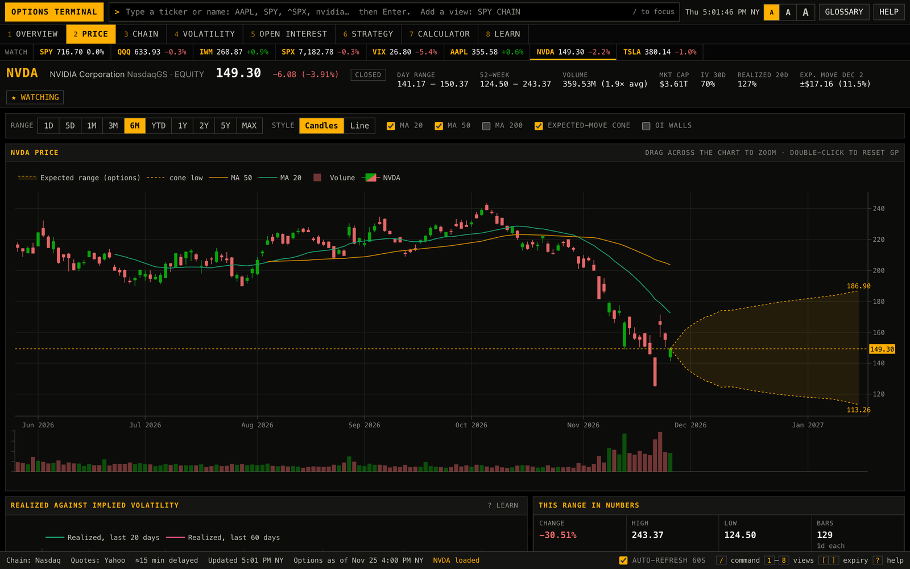
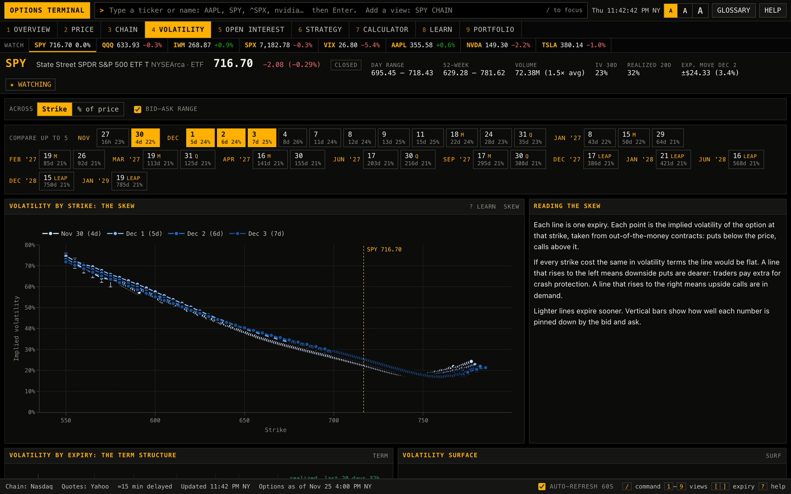
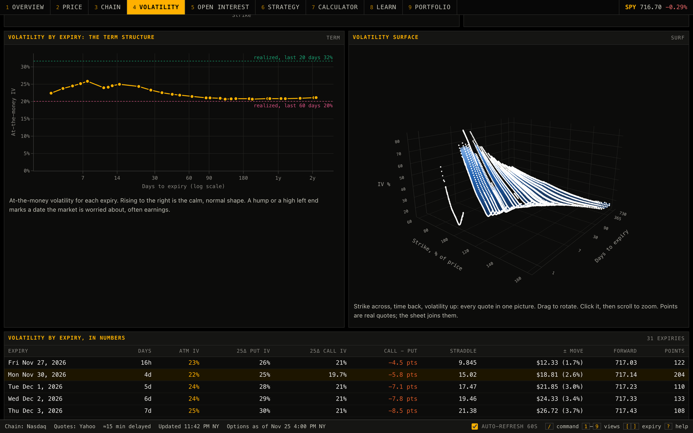
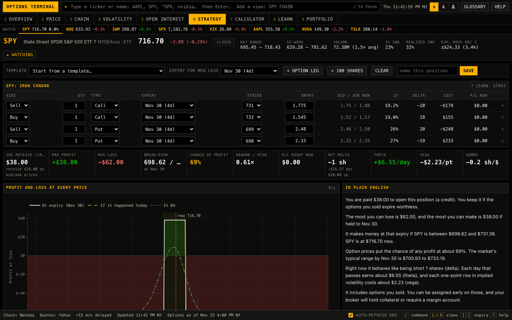
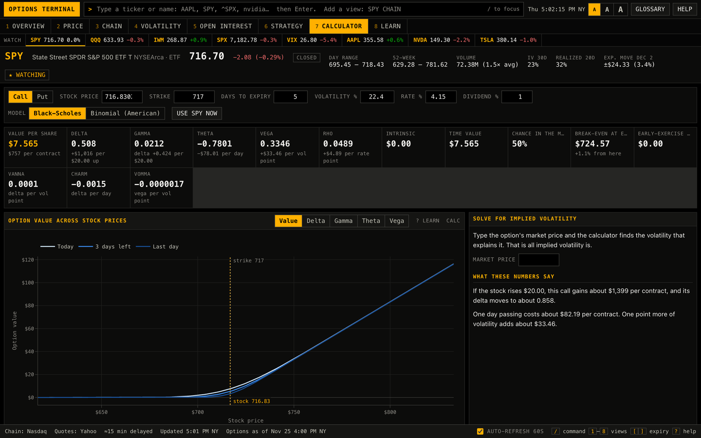
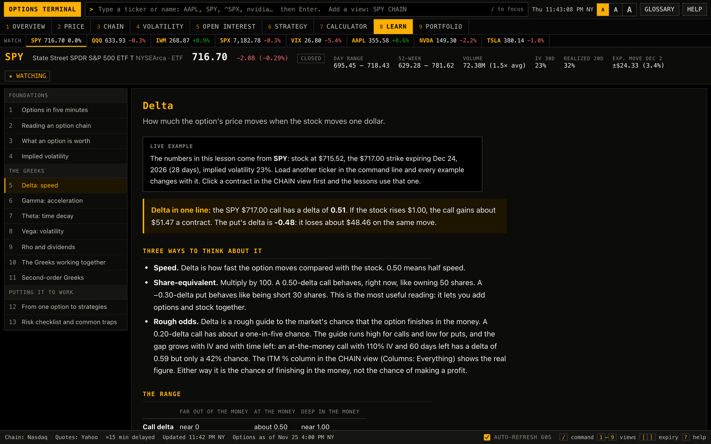
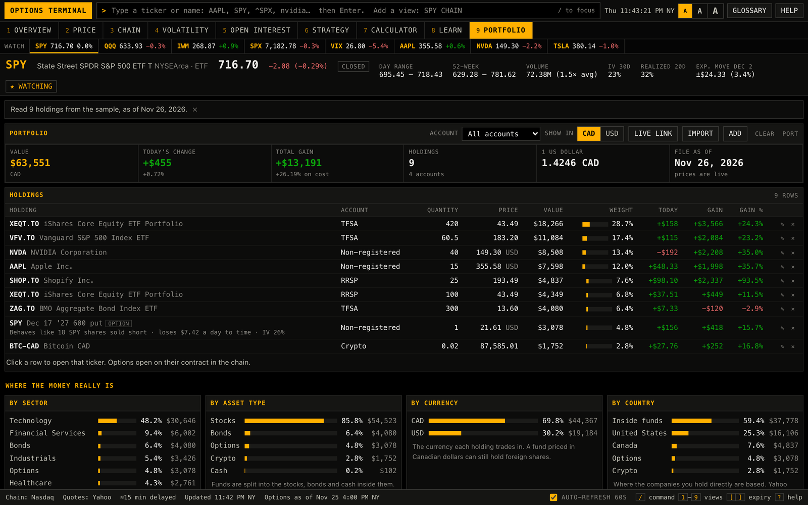
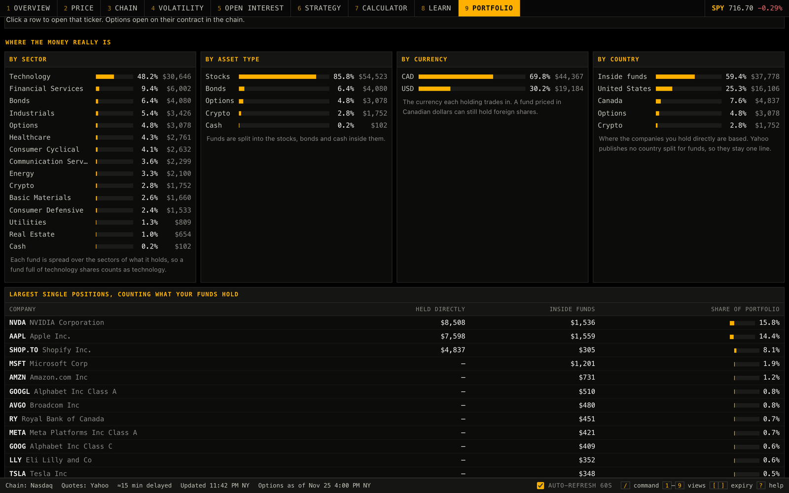
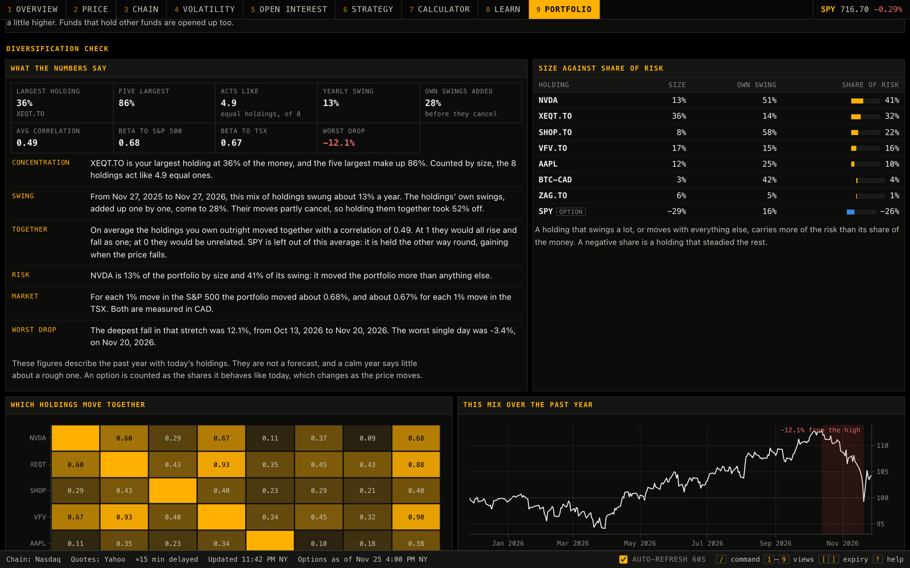
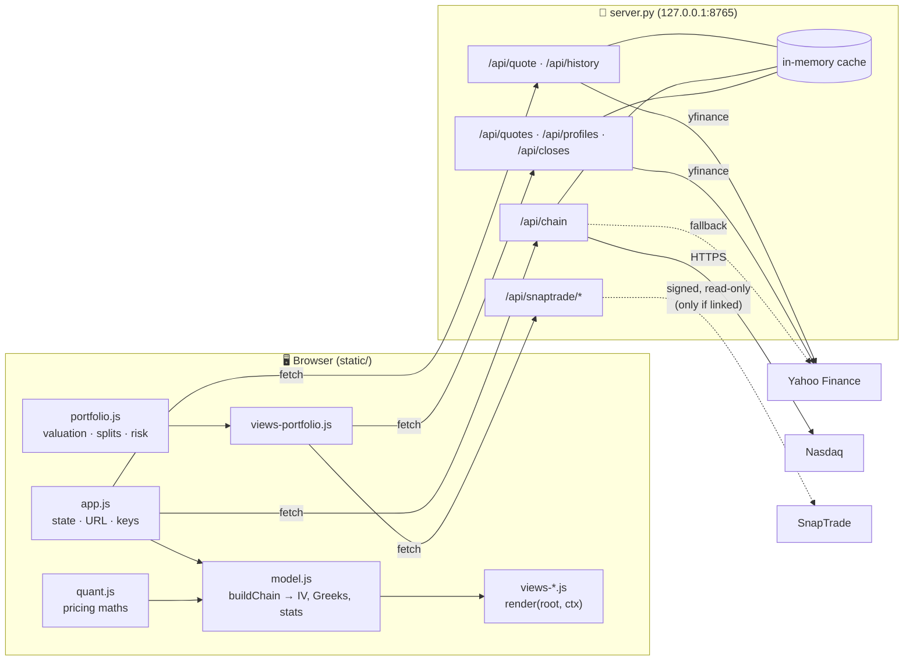

<div align="center">

# 📈 Options Terminal

**A Bloomberg-style options and portfolio terminal that runs on your own machine.**
Load any US stock, ETF or index and get its full option chain, volatility skew and 3D surface, open interest,
a multi-leg strategy builder, a pricing calculator and an interactive course on the Greeks.
Then bring in your own holdings to see what they're worth, where the money really is, and how diversified you are.

No account. No API key. No build step.


[](LICENSE)

[🌐 Website](https://pseudocoder28.github.io/options-viewer/) · [New here?](#-new-to-options-or-investing-start-here) · [Quick start](#-quick-start) · [Features](#-features) · [Screenshots](#-tour) · [Portfolio](#-your-portfolio) · [How it works](#-how-it-works) · [Tests](#-tests)

<br/>


<sub>Type a ticker, then press <kbd>1</kbd>–<kbd>9</kbd> to step through the views. · <a href="docs/demo.mp4">Full-quality video (MP4)</a></sub>

</div>

---

## 💡 New to options or investing? Start here

**What's an option?** It's like paying a small deposit to hold a price. Say you pay a seller $5k for the right to
buy a $500k house at that price any time in the next 3 months. If prices jump to $600k, your deal is worth a lot. If
prices fall, you walk away and lose only the $5k. Stock options work the same way, but for shares of companies like Apple.

- **Call**: a bet that the price goes up.
- **Put**: a bet that the price goes down, or insurance against a fall.

**What does this app do?** For any company, thousands of options trade at different prices and end dates. That's a
wall of numbers. Options Terminal pulls that data for free and turns it into charts and plain-English summaries.
You can see what traders expect a stock to do, how nervous they are, and where the big bets sit. You can also test
a trade to see your profit or loss before risking real money, learn the basics in built-in lessons, and check how
well spread out your own investments are.

**What's the Portfolio tab?** It's a health check for your investments. You might own 10 different things and feel
safe, but if most of them are tech stocks, or funds that secretly hold the same big companies, one bad week for tech
hits almost everything you own. That's putting all your eggs in one basket without realising it. Give the app your
list of holdings (a file from your brokerage, or typed in by hand) and it shows:

- **What you own and what it's worth** today, and how much you've gained or lost.
- **Where your money really sits**: by industry, country and currency. It even looks inside funds, so you can see
  that your "S&P 500 fund" is really a lot of Apple, Microsoft and Nvidia.
- **How risky the mix is**: which holdings swing the most, which ones rise and fall together, and the biggest drop the
  whole portfolio took in the past year.

Your list stays on your computer. The app only looks up prices, and it never buys or sells anything.

> **In one line:** a free, simple version of the expensive terminals professional traders use, and it explains what it shows in plain English.

---

## ✨ Features

| | |
|---|---|
| 🧭 **Plain-English overview** | Reads the whole chain for you: expected move, volatility vs. history, skew, term structure, positioning, liquidity |
| 🔗 **Full option chain** | Calls and puts by strike with IV and Greeks; table or heatmap; click any contract for an explanation and what-if sliders |
| 🌋 **Volatility** | Skew by strike across expiries, term structure, and a 3D volatility surface you can drag to turn and scroll to zoom |
| 🧱 **Open interest & flow** | OI and volume by strike, max pain, and estimated dealer gamma exposure |
| 🧮 **Strategy builder** | 14 templates (spreads, straddles, iron condor, butterfly, covered call, collar…) with payoff chart, break-evens, chance of profit and net Greeks |
| 🧪 **Pricing calculator** | Black-Scholes and Binomial (American) models, implied-volatility solver, first- and second-order Greeks |
| 🎓 **Learn** | 13 interactive lessons on options and the Greeks, built on live data, with sliders and quizzes |
| 💼 **Portfolio** | Import holdings (Wealthsimple CSV, any CSV, or by hand) and see value, sector/asset/currency/country splits with funds opened up, and a full diversification and risk check |
| 🔌 **Live brokerage link** | Optional, **read-only** link through SnapTrade that keeps your holdings and cash in sync |
| ⌨️ **Keyboard-first** | Command line for tickers and views, number keys for views, arrow-key navigation through the chain |
| 🔖 **Every screen is a link** | Ticker, view, expiry, selected contract and strategy legs all live in the URL; Back works as expected |
| 🔒 **Local and private** | The server binds to `127.0.0.1` and only answers its own page. Your holdings file never leaves the browser |

**By the numbers:** ~16,000 lines of code · 9 views · 13 lessons · 14 strategy templates · 37 automated checks ·
1 Python dependency (`yfinance`) · 0 build tools

---

## 🚀 Quick start

**You need:** [uv](https://docs.astral.sh/uv/) (it fetches Python and `yfinance` on the first run) and an internet connection.
Node 18+ is only needed to run the tests.

```bash
git clone https://github.com/Pseudocoder28/options-viewer.git
cd options-viewer
uv run server.py
```

That opens **http://127.0.0.1:8765**. Use `--port 9000` for another port, or `--no-browser` to skip opening a tab.

### 🍎 macOS app (optional)

```bash
python3 make_app.py
```

This builds **`Options Terminal.app`** in the project folder. Double-click it or drag it to the Dock. It starts the
server if needed, opens the terminal, and shuts the server down 15 minutes after the last tab closes.
Rebuild it if you move the folder.

---

## 🖼️ Tour

<table>
<tr>
<td width="50%"><b>1 · Overview</b>: the chain explained in plain English<br/></td>
<td width="50%"><b>2 · Price</b>: candles, moving averages and the option-implied range<br/></td>
</tr>
<tr>
<td><b>3 · Chain</b>: calls, strikes, puts, IV, delta and a plain-English panel<br/></td>
<td><b>4 · Volatility</b>: the skew across every expiry<br/></td>
</tr>
<tr>
<td><b>4 · Volatility</b>: term structure and the 3D surface (drag to turn, scroll to zoom)<br/></td>
<td><b>5 · Open interest</b>: positioning, volume, max pain, dealer gamma<br/></td>
</tr>
<tr>
<td><b>6 · Strategy</b>: an iron condor with payoff, odds and net Greeks<br/></td>
<td><b>7 · Calculator</b>: price any option and solve for implied volatility<br/></td>
</tr>
<tr>
<td><b>8 · Learn</b>: interactive lessons with live examples<br/></td>
<td><b>9 · Portfolio</b>: holdings, value, today's change and gain<br/></td>
</tr>
<tr>
<td><b>9 · Portfolio</b>: where the money really is, with funds opened up<br/></td>
<td><b>9 · Portfolio</b>: the diversification and risk check<br/></td>
</tr>
</table>

<sub>The portfolio screenshots use the app's built-in made-up sample portfolio.</sub>

---

## ⌨️ Using it

Type a ticker in the command line and press <kbd>Enter</kbd> (`AAPL`, `SPY`, `^SPX`). Company names work too (`nvidia`).
Add a view after the ticker to jump straight to it: `SPY CHAIN`, `TSLA VOL`, `QQQ STRAT`. Type `PORTFOLIO` to open your holdings.

| Key | Action | | Key | Action |
|:---:|---|---|:---:|---|
| <kbd>1</kbd> | Overview | | <kbd>/</kbd> | Jump to the command line |
| <kbd>2</kbd> | Price | | <kbd>[</kbd> <kbd>]</kbd> | Previous / next expiry |
| <kbd>3</kbd> | Chain | | <kbd>r</kbd> | Reload data |
| <kbd>4</kbd> | Volatility | | <kbd>g</kbd> | Glossary |
| <kbd>5</kbd> | Open interest | | <kbd>?</kbd> | List every shortcut |
| <kbd>6</kbd> | Strategy | | <kbd>↑</kbd> <kbd>↓</kbd> <kbd>←</kbd> <kbd>→</kbd> | Move through the chain |
| <kbd>7</kbd> | Calculator | | <kbd>Enter</kbd> | Open the contract under the cursor |
| <kbd>8</kbd> | Learn | | <kbd>Esc</kbd> | Close the contract panel |
| <kbd>9</kbd> | Portfolio | | | |

<details>
<summary><b>Good to know</b></summary>

- **The address bar is a bookmark.** It stores the ticker, view, expiry, selected contract, strategy legs and lesson.
- **Your browser remembers the rest**: watchlist, strategy legs, saved positions, portfolio holdings, lesson progress,
  calculator inputs, chart range and text size. A different browser, or cleared site data, starts empty.
- **Auto-refresh runs every minute.** It pauses on Learn, Calculator and Strategy, and while a slider is in use.
  The Portfolio view refreshes its prices on the same beat.
- **Estimates are marked.** An IV in *italics* is read off the curve rather than from that contract's own quote.
  Grey figures are borrowed from a neighbouring expiry or extrapolated from far strikes.
- **The 3D surface** turns when you drag it. The mouse wheel zooms it only after you click it, so scrolling the page
  doesn't get caught on the chart.
- The command bar tucks away as you scroll down. <kbd>A</kbd> <kbd>A</kbd> <kbd>A</kbd> sets the text size.
  On the Price view, drag across the chart to zoom into a date range; double-click to reset.

</details>

---

## 💼 Your portfolio

The Portfolio view (<kbd>9</kbd>, or `PORTFOLIO` in the command line) works on a list of holdings you give it.

**Getting your holdings in**

| Way | How |
|---|---|
| 📄 **Wealthsimple** | On the web: Documents → custom download → *Holdings report (CSV)* → choose accounts → download. Drop the file on the Portfolio view, or press **IMPORT** |
| 🧾 **Any other CSV** | Needs a symbol column and a quantity column. Optional: `Book Value`, `Currency`, `Account`, `Name`. Use Yahoo tickers: Toronto listings end in `.TO`, coins look like `BTC-CAD` |
| ✍️ **By hand** | **ADD** takes a ticker and quantity; an option takes its underlying, expiry, strike and type |
| 🧪 **Just looking** | **TRY A SAMPLE PORTFOLIO** loads a made-up one |
| 🔌 **Live, no file** | Link your brokerage (below) |

The file is read **in your browser** and never uploaded. Only ticker symbols leave it, to fetch prices. Account
numbers are not kept.

**What it shows**

- **Holdings**: value, weight, today's change and gain, in CAD or USD. Options are priced from their live chain and
  shown as the shares they behave like, plus what they lose per day.
- **Where the money really is**: by sector, asset type, currency and country. Funds are opened up into the stocks,
  bonds and cash inside them, and a table lists your largest single companies counting what your funds hold.
- **Diversification check**: concentration, how much the mix swung over the past year, which holdings carried the
  risk, how holdings move together, beta to the S&P 500 and the TSX, and the deepest fall.

<details>
<summary><b>🔌 The live brokerage link (optional, read-only)</b></summary>

With it, the Portfolio view reads your holdings and cash from your brokerage through
[SnapTrade](https://snaptrade.com/personal), a separate company. It reads again every 15 minutes while the tab is open,
and whenever you press **SYNC**.

> [!WARNING]
> Wealthsimple has no public API, so SnapTrade signs in with your Wealthsimple login, which you type into SnapTrade's
> page (never into this app). Wealthsimple's Account Security Guarantee asks you not to share your login with another
> organisation. Read its terms and decide whether that suits you. The file import works either way.

**Setup:** press **LIVE LINK** on the Portfolio view and follow the three steps:

1. Create a free Personal account at SnapTrade and turn on two-factor sign-in.
2. Create a Personal API key in its dashboard and paste its two values into the dialog.
3. Press **CONNECT A BROKERAGE**, sign in on SnapTrade's page, come back and press **SYNC NOW**.

**What it does and doesn't do**

- **Read-only.** It only asks for accounts, positions, cash and connection status. The connection is opened for data
  access only, and if SnapTrade ever reports one that can trade, the dialog says so.
- **Keys stay local** in `~/.config/options-terminal/snaptrade.json`, readable only by you, never sent to the page or
  logged. **UNLINK** deletes them.
- **Hand-added holdings stay.** A sync replaces what the brokerage reports and keeps what you typed in.
- **Cash** shows as its own line in every split. Account numbers are left behind.

</details>

<details>
<summary><b>Limits of the portfolio figures</b></summary>

- **It measures and describes.** It doesn't recommend what to buy or sell.
- **The past year is not a forecast.** A calm year says little about a rough one.
- **Funds are only partly visible.** Yahoo gives a fund's sector mix but only its ten largest holdings, and no
  country split.
- **Options are counted by delta**, which changes as the price moves.
- **No live price?** The holding is valued at the file's price and marked; with no price at all it's left out and listed.
- **Two currencies.** CAD and USD holdings are handled; anything else is left out.

</details>

---

## 📡 Where the data comes from

All sources are free and need no key. Data is **about 15 minutes delayed**.

| Data | Source |
|---|---|
| Option chains | **Nasdaq** public feed (full listing for stocks and ETFs), falling back to **Yahoo Finance** (most indexes: SPX, VIX, NDX, RUT) |
| Quotes, price history, ticker search, risk-free rate | **Yahoo Finance** via `yfinance` |
| What a holding is, what a fund holds, USD/CAD rate | **Yahoo Finance** |
| Your holdings, if you link a brokerage | **SnapTrade**, read-only. Nothing is asked of it until you set up the link |
| Implied volatility, Greeks, portfolio maths | **Computed in your browser** (Black-Scholes-Merton for options) |

<details>
<summary><b>Limits of the options model</b></summary>

- **Delayed prices.** Never time an order from this screen; check your broker's live quote.
- **Closed market.** Quotes freeze at the close, so IV and Greeks are computed as of the close
  (the status bar says *"Options as of …"*).
- **Early exercise.** The main model assumes European exercise. Deep in-the-money American puts are worth a little
  more; the Calculator's Binomial model shows the difference.
- **Thin chains.** Few usable quotes means rough outputs, and the app says so.
- **Chance of profit** assumes a single log-normal distribution at the first expiry's ATM volatility. It ignores skew,
  costs and early exits.

</details>

---

## 🏗️ How it works



The **server only fetches, caches and repackages** data. **All the maths runs in the browser**, in plain JavaScript
modules with no build step: edit a file and reload the page.

The server listens on `127.0.0.1` only and rejects requests that don't come from its own page (Host and
`Sec-Fetch-Site` checks), so other websites can't use it. Its write endpoints (the SnapTrade keys) accept JSON from the
app's own page only.

<details>
<summary><b>📂 Project structure</b></summary>

```
options-viewer/
├── server.py                 # data server: endpoints, Nasdaq + Yahoo chain sources, SnapTrade link, cache
├── make_app.py               # builds the double-click macOS launcher
├── tests.mjs                 # runs every check: pricing, model, strategy, portfolio, live chains
├── tests-model.mjs           # chain-model checks on synthetic chains with known answers
├── tests-portfolio.mjs       # portfolio checks: file and brokerage readers, valuation, splits, risk
├── .prettierrc.json          # code style (120 columns)
└── static/
    ├── index.html            # page shell
    ├── app.css               # every style
    └── js/
        ├── app.js            # state, loading, URL, command line, keyboard, list of views
        ├── model.js          # chain model and strategy maths (data shapes documented at the top)
        ├── quant.js          # Black-Scholes, binomial tree, IV solver, Greeks (units documented at the top)
        ├── explain.js        # plain-English readings
        ├── views-market.js   # Overview and Price
        ├── views-chain.js    # Chain and the contract panel
        ├── views-vol.js      # Volatility and Open interest
        ├── views-strategy.js # Strategy builder and Calculator
        ├── portfolio.js      # portfolio maths as pure functions
        ├── views-portfolio.js# Portfolio view: import, live link, table and panels
        ├── learn.js          # lesson text
        ├── learn-widgets.js  # interactive lesson widgets
        ├── glossary.js       # hover tips and glossary
        ├── expiries.js       # shared expiry picker
        ├── payoff.js         # shared P&L chart
        ├── ui.js             # page and chart helpers
        └── fmt.js            # number and date formatting
```

Start reading at `static/js/app.js`, then `model.js`, then any one view. The Portfolio view stands a little apart:
read `portfolio.js`, then `views-portfolio.js`.

</details>

<details>
<summary><b>🔧 Extending it</b></summary>

- **A new view**: write `render(root, ctx)` in a views file and add it to `VIEWS` in `app.js`.
- **A new lesson**: add an entry to `LESSONS` in `learn.js`.
- **A new glossary term**: add it to `TERMS` in `glossary.js`.
- **Another data source** (a real-time feed, say): write `chain_<name>(symbol, kind)` in `server.py` returning the same
  rows as `chain_nasdaq`, and put it first in `get_chain()`.

**Code style.** JavaScript, CSS and HTML are formatted by [Prettier](https://prettier.io) at 120 columns. After editing:

```bash
npx prettier@3.10.1 --write .
```

`server.py` and `make_app.py` are wrapped by hand to the same width. On-screen text (lessons, glossary entries, tips)
stays on one line so anything you see in the app can be found by searching the code.

</details>

---

## ✅ Tests

```bash
node tests.mjs
```

**37 checks.** 28 run offline: pricing formulas against textbook and reference values, the chain model on synthetic
chains with known answers, strategy maths, hostile input from links, and the portfolio maths (holdings and brokerage
readers, valuation, breakdowns and risk) on inputs with known answers. With the server running, 9 more build live
chains for GEMI, SPY, SPX and VIX and price and measure the sample portfolio. Set `TERMINAL_URL` if the server is on
another port.

```
ok  ^SPX: chain builds and every number is sane (22268 contracts, 57 expiries, 183 ms, Yahoo, live)
ok  live sample: every holding is priced (8 tickers, total C$63112)
ok  live sample: a year of prices gives believable risk numbers

37 checks passed
```

`server.py` also runs a self-test at every start: its parsing rules and the way it signs SnapTrade requests.

---

## 🩺 Troubleshooting

| Symptom | Fix |
|---|---|
| *"Cannot reach the local data server"* | The server stopped. Reopen the app or run `uv run server.py`, then press **RETRY** |
| The app icon does nothing | It needs `uv` installed. It always uses port 8765 and logs to `~/Library/Logs/OptionsTerminal.log` |
| *"REFRESH FAILED"* in the status bar | The latest update didn't arrive. It retries every minute; press <kbd>r</kbd> to try now |
| No options for a ticker | Free sources don't list options for crypto, futures, most funds and many foreign shares. Price views still work |
| *"Your brokerage could not be read"* | The banner gives SnapTrade's reason. A stale connection needs signing in again: **LINK** → **CONNECT A BROKERAGE**. Refused keys were pasted incompletely or deleted in SnapTrade |
| A holdings file is refused | It needs a heading row with a symbol column and a quantity column. A holding marked **FILE PRICE** has a ticker Yahoo doesn't know: press ✎ to fix it |
| Charts are missing | Plotly loads from a CDN. Check your connection and reload |

---

## ⚠️ Disclaimer

This is a learning and analysis tool. The data is delayed and unofficial, **nothing here is investment advice**,
and the app cannot place orders.

---

## 📄 License

Released under the [MIT License](LICENSE). © 2026 Naman Shah.

<div align="center">
<sub>Built by <a href="https://github.com/Pseudocoder28">@Pseudocoder28</a></sub>
</div>
