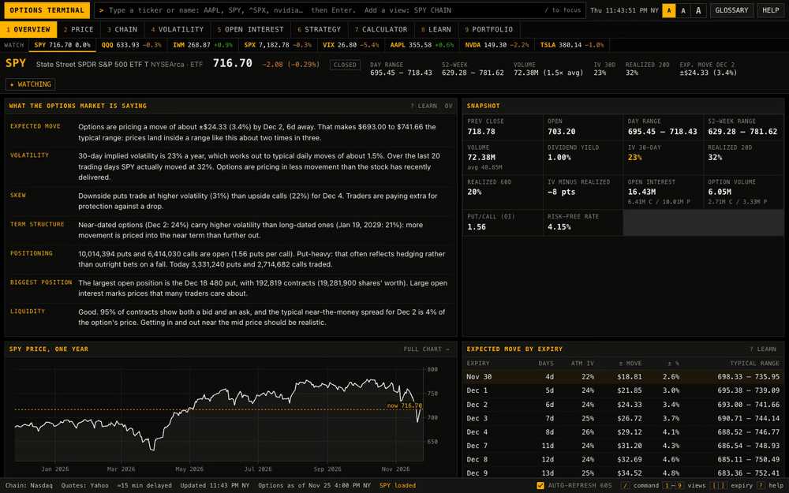
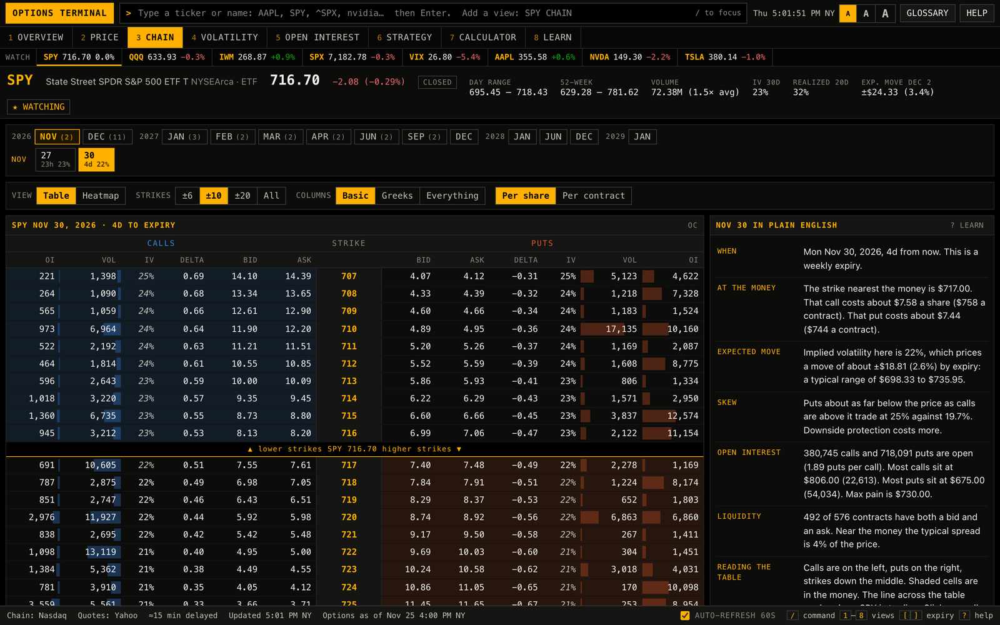
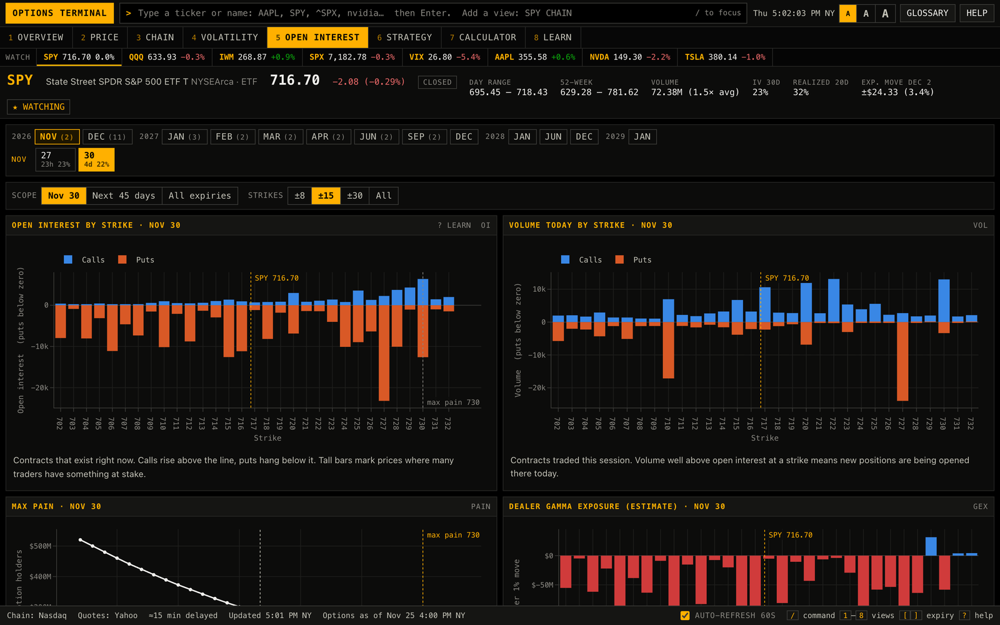
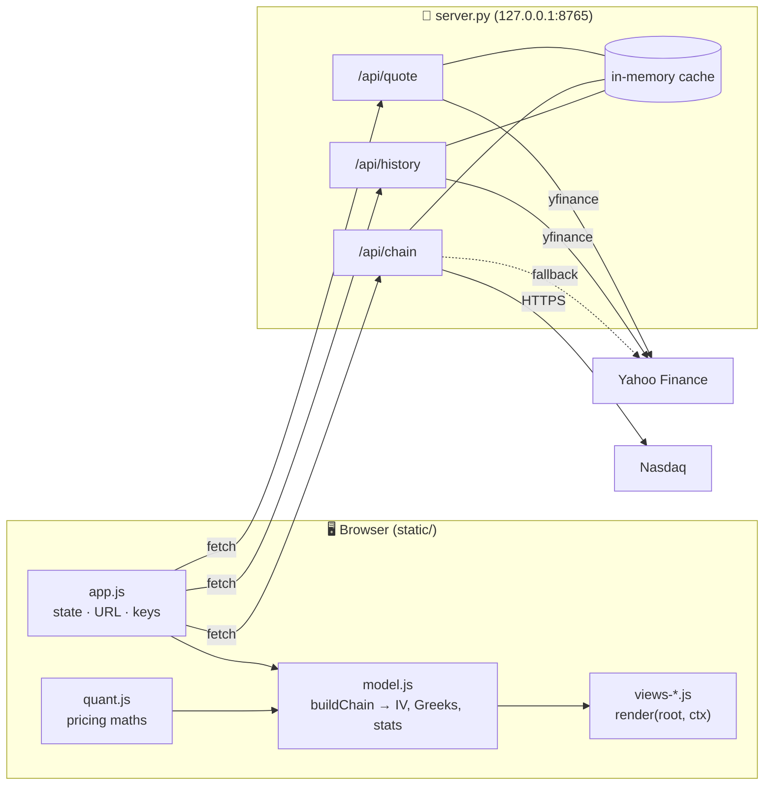

<div align="center">

# 📈 Options Terminal

**A Bloomberg-style options analysis terminal that runs on your own machine.**
Load any US stock, ETF or index and get its full option chain, volatility skew and surface, open interest,
a multi-leg strategy builder, a pricing calculator and an interactive course on the Greeks.

No account. No API key. No build step.


[](LICENSE)

[Quick start](#-quick-start) · [Features](#-features) · [Screenshots](#-tour) · [How it works](#-how-it-works) · [Tests](#-tests)

<br/>



<sub>Type a ticker, then press <kbd>1</kbd>–<kbd>8</kbd> to step through the views. · <a href="docs/demo.mp4">Full-quality video (MP4)</a></sub>

</div>

---

## ✨ Features

| | |
|---|---|
| 🧭 **Plain-English overview** | Reads the whole chain for you: expected move, volatility vs. history, skew, term structure, positioning, liquidity |
| 🔗 **Full option chain** | Calls and puts by strike with IV and Greeks; table or heatmap; click any contract for an explanation and what-if sliders |
| 🌋 **Volatility** | Skew by strike across expiries, term structure, and a rotatable 3D volatility surface |
| 🧱 **Open interest & flow** | OI and volume by strike, max pain, and estimated dealer gamma exposure |
| 🧮 **Strategy builder** | 14 templates (spreads, straddles, iron condor, butterfly, covered call, collar…) with payoff chart, break-evens, chance of profit and net Greeks |
| 🧪 **Pricing calculator** | Black-Scholes and Binomial (American) models, implied-volatility solver, first- and second-order Greeks |
| 🎓 **Learn** | 13 interactive lessons on options and the Greeks, built on live data, with sliders and quizzes |
| ⌨️ **Keyboard-first** | Command line for tickers and views, number keys for views, arrow-key navigation through the chain |
| 🔖 **Every screen is a link** | Ticker, view, expiry, selected contract and strategy legs all live in the URL; Back works as expected |
| 🔒 **Local and private** | The server binds to `127.0.0.1` and only answers its own page. Your watchlist and positions stay in your browser |

**By the numbers:** ~5,300 lines of code · 8 views · 13 lessons · 14 strategy templates · 24 automated checks ·
1 Python dependency (`yfinance`) · 0 build tools

---

## 🚀 Quick start

**You need:** [uv](https://docs.astral.sh/uv/) (it fetches Python and `yfinance` on the first run) and an internet connection.
Node 18+ is only needed to run the tests.

```bash
git clone https://github.com/Pseudocoder28/options-viewer.git
cd options-viewer
uv run server.py
```

That opens **http://127.0.0.1:8765**. Use `--port 9000` for another port, or `--no-browser` to skip opening a tab.

### 🍎 macOS app (optional)

```bash
python3 make_app.py
```

This builds **`Options Terminal.app`** in the project folder. Double-click it or drag it to the Dock. It starts the
server if needed, opens the terminal, and shuts the server down 15 minutes after the last tab closes.
Rebuild it if you move the folder.

---

## 🖼️ Tour

<table>
<tr>
<td width="50%"><b>1 · Overview</b>: the chain explained in plain English<br/></td>
<td width="50%"><b>2 · Price</b>: candles, moving averages and the option-implied range<br/></td>
</tr>
<tr>
<td><b>3 · Chain</b>: calls, strikes, puts, IV, delta and a plain-English panel<br/></td>
<td><b>4 · Volatility</b>: skew across expiries, term structure, 3D surface<br/></td>
</tr>
<tr>
<td><b>5 · Open interest</b>: positioning, volume, max pain, dealer gamma<br/></td>
<td><b>6 · Strategy</b>: an iron condor with payoff, odds and net Greeks<br/></td>
</tr>
<tr>
<td><b>7 · Calculator</b>: price any option and solve for implied volatility<br/></td>
<td><b>8 · Learn</b>: interactive lessons with live examples<br/></td>
</tr>
</table>

---

## ⌨️ Using it

Type a ticker in the command line and press <kbd>Enter</kbd> (`AAPL`, `SPY`, `^SPX`). Company names work too (`nvidia`).
Add a view after the ticker to jump straight to it: `SPY CHAIN`, `TSLA VOL`, `QQQ STRAT`.

| Key | Action | | Key | Action |
|:---:|---|---|:---:|---|
| <kbd>1</kbd> | Overview | | <kbd>/</kbd> | Jump to the command line |
| <kbd>2</kbd> | Price | | <kbd>[</kbd> <kbd>]</kbd> | Previous / next expiry |
| <kbd>3</kbd> | Chain | | <kbd>r</kbd> | Reload data |
| <kbd>4</kbd> | Volatility | | <kbd>g</kbd> | Glossary |
| <kbd>5</kbd> | Open interest | | <kbd>?</kbd> | List every shortcut |
| <kbd>6</kbd> | Strategy | | <kbd>↑</kbd> <kbd>↓</kbd> <kbd>←</kbd> <kbd>→</kbd> | Move through the chain |
| <kbd>7</kbd> | Calculator | | <kbd>Enter</kbd> | Open the contract under the cursor |
| <kbd>8</kbd> | Learn | | <kbd>Esc</kbd> | Close the contract panel |

<details>
<summary><b>Good to know</b></summary>

- **The address bar is a bookmark.** It stores the ticker, view, expiry, selected contract, strategy legs and lesson.
- **Your browser remembers the rest**: watchlist, strategy legs, saved positions, lesson progress, calculator inputs,
  chart range and text size. A different browser, or cleared site data, starts empty.
- **Auto-refresh runs every minute.** It pauses on Learn, Calculator and Strategy, and while a slider is in use.
- **Estimates are marked.** An IV in *italics* is read off the curve rather than from that contract's own quote.
  Grey figures are borrowed from a neighbouring expiry or extrapolated from far strikes.
- The command bar tucks away as you scroll down. <kbd>A</kbd> <kbd>A</kbd> <kbd>A</kbd> sets the text size.
  On the Price view, drag across the chart to zoom into a date range; double-click to reset.

</details>

---

## 📡 Where the data comes from

All sources are free and need no key. Data is **about 15 minutes delayed**.

| Data | Source |
|---|---|
| Option chains | **Nasdaq** public feed (full listing for stocks and ETFs), falling back to **Yahoo Finance** (most indexes: SPX, VIX, NDX, RUT) |
| Quotes, price history, ticker search, risk-free rate | **Yahoo Finance** via `yfinance` |
| Implied volatility and Greeks | **Computed in your browser** from bid/ask with Black-Scholes-Merton |

<details>
<summary><b>Limits of the model</b></summary>

- **Delayed prices.** Never time an order from this screen; check your broker's live quote.
- **Closed market.** Quotes freeze at the close, so IV and Greeks are computed as of the close
  (the status bar says *"Options as of …"*).
- **Early exercise.** The main model assumes European exercise. Deep in-the-money American puts are worth a little
  more; the Calculator's Binomial model shows the difference.
- **Thin chains.** Few usable quotes means rough outputs, and the app says so.
- **Chance of profit** assumes a single log-normal distribution at the first expiry's ATM volatility. It ignores skew,
  costs and early exits.

</details>

---

## 🏗️ How it works



The **server only fetches, caches and repackages** data. **All the maths runs in the browser**, in plain JavaScript
modules with no build step: edit a file and reload the page.

The server listens on `127.0.0.1` only and rejects requests that don't come from its own page (Host and
`Sec-Fetch-Site` checks), so other websites can't use it.

<details>
<summary><b>📂 Project structure</b></summary>

```
options-viewer/
├── server.py               # data server: endpoints, Nasdaq + Yahoo chain sources, cache (stdlib + yfinance)
├── make_app.py             # builds the double-click macOS launcher
├── tests.mjs               # pricing, model, strategy and live-chain checks
├── tests-model.mjs         # chain-model checks on synthetic chains with known answers
└── static/
    ├── index.html          # page shell
    ├── app.css             # every style
    └── js/
        ├── app.js          # state, loading, URL, command line, keyboard, list of views
        ├── model.js        # chain model and strategy maths (data shapes documented at the top)
        ├── quant.js        # Black-Scholes, binomial tree, IV solver, Greeks (units documented at the top)
        ├── explain.js      # plain-English readings
        ├── views-market.js # Overview and Price
        ├── views-chain.js  # Chain and the contract panel
        ├── views-vol.js    # Volatility and Open interest
        ├── views-strategy.js # Strategy builder and Calculator
        ├── learn.js        # lesson text
        ├── learn-widgets.js# interactive lesson widgets
        ├── glossary.js     # hover tips and glossary
        ├── expiries.js     # shared expiry picker
        ├── payoff.js       # shared P&L chart
        ├── ui.js           # page and chart helpers
        └── fmt.js          # number and date formatting
```

Start reading at `static/js/app.js`, then `model.js`, then any one view.

</details>

<details>
<summary><b>🔧 Extending it</b></summary>

- **A new view**: write `render(root, ctx)` in a views file and add it to `VIEWS` in `app.js`.
- **A new lesson**: add an entry to `LESSONS` in `learn.js`.
- **A new glossary term**: add it to `TERMS` in `glossary.js`.
- **Another data source** (a real-time feed, say): write `chain_<name>(symbol, kind)` in `server.py` returning the same
  rows as `chain_nasdaq`, and put it first in `get_chain()`.

</details>

---

## ✅ Tests

```bash
node tests.mjs
```

**24 checks.** 18 run offline: pricing formulas against textbook and reference values, the chain model on synthetic
chains with known answers, strategy maths, and hostile input from links. With the server running, the other 6 build
live chains for GEMI, SPY, SPX and VIX and check that every number is sane. Set `TERMINAL_URL` if the server is on
another port.

```
ok  ^SPX: chain builds and every number is sane (22268 contracts, 57 expiries, 180 ms, Yahoo, live)
ok  ^VIX: chain builds and every number is sane (1097 contracts, 11 expiries, 6 ms, Yahoo, live)

24 checks passed
```

`server.py` also runs a self-test of its parsing rules every time it starts.

---

## 🩺 Troubleshooting

| Symptom | Fix |
|---|---|
| *"Cannot reach the local data server"* | The server stopped. Reopen the app or run `uv run server.py`, then press **RETRY** |
| The app icon does nothing | It needs `uv` installed. It always uses port 8765 and logs to `~/Library/Logs/OptionsTerminal.log` |
| *"REFRESH FAILED"* in the status bar | The latest update didn't arrive. It retries every minute; press <kbd>r</kbd> to try now |
| No options for a ticker | Free sources don't list options for crypto, futures, most funds and many foreign shares. Price views still work |
| Charts are missing | Plotly loads from a CDN. Check your connection and reload |

---

## ⚠️ Disclaimer

This is a learning and analysis tool. The data is delayed and unofficial, **nothing here is investment advice**,
and the app cannot place orders.

---

## 📄 License

Released under the [MIT License](LICENSE). © 2026 Pseudocoder28.

<div align="center">
<sub>Built by <a href="https://github.com/Pseudocoder28">@Pseudocoder28</a></sub>
</div>
